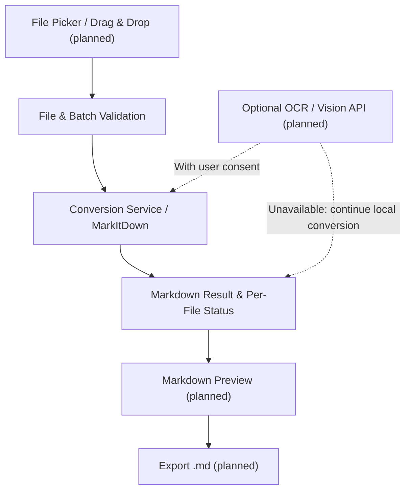

<div align="center">

# 📄 Document to Markdown
### Hybrid Desktop Converter

**Multi-format document conversion. Local-first processing. Optional OCR and Vision enhancements.**

[](#development-roadmap)
[](#technology-stack)
[](#technology-stack)
[](#conversion-architecture)

**[Overview](#overview) · [Features](#planned-application-features) · [Formats](#target-formats) · [Architecture](#conversion-architecture) · [Roadmap](#development-roadmap) · [Credits](#license--credits)**

</div>

---

## Overview

**Document to Markdown Desktop Converter** is an independent Python portfolio project for a Windows desktop application that converts common document formats into readable Markdown (`.md`). The intended experience is straightforward: select or drop documents, convert them, preview the Markdown, and export the results.

The production conversion engine is [Microsoft MarkItDown](https://github.com/microsoft/markitdown). Rather than reimplementing format-specific conversion algorithms, the project focuses on the desktop workflow and the software around that engine: file validation, same-extension batch processing, per-file outcomes, Markdown preview and export, error handling, testing, and Windows packaging.

> [!IMPORTANT]
> **Development status:** MarkItDown 0.1.9 is integrated as the default local conversion engine, with basic smoke verification completed for TXT, DOCX, and text-based PDF files on Python 3.13. Earlier work on a custom TXT converter is retained as an experimental learning milestone, but that approach has been superseded for production. **The remaining MVP formats, batch workflow, complete GUI, OCR/Vision enhancements, and packaged Windows release are not yet confirmed complete.**

This is an independent application that uses MarkItDown; it is **not an official Microsoft product**.

## Planned Application Features

<table>
<tr>
<td width="50%" valign="top">

### 🖱️ Desktop File Selection
Select files using a Windows file picker or drag and drop them into the planned PySide6 interface.

</td>
<td width="50%" valign="top">

### 📚 Multi-Format Conversion
Use MarkItDown as the primary engine. TXT, DOCX, and text-based PDF have basic verification; the remaining target formats still require representative tests.

</td>
</tr>
<tr>
<td valign="top">

### 🗂️ Same-Extension Batches
Process multiple files in one batch **only when they share the same file extension** (case-insensitive). Each input produces its own Markdown file and success/failure status.

</td>
<td valign="top">

### 👁️ Preview & Export
Review generated Markdown before export and choose an output location, with clear handling of filenames, overwrites, and file errors.

</td>
</tr>
<tr>
<td valign="top">

### 🔒 Local-First Operation
Use local conversion by default, without requiring a cloud API key or document upload for supported local workflows.

</td>
<td valign="top">

### 🧠 Optional OCR & Vision
Plan image-text extraction and visual descriptions with explicit user consent and a configured online Vision API. Local conversion remains available if online processing is unavailable.

</td>
</tr>
</table>

> These are **target features**, not a statement that all features are implemented. Conversion quality and supported enhancements will be established through integration tests.

## Target Formats

The MVP targets the following inputs. Each format's output quality must be verified with representative documents.

| Category | File extensions | Verification status |
|---|---|---|
| Plain text | `.txt` | Basic smoke test passed |
| Word | `.docx` | Basic smoke test passed |
| PDF | `.pdf` | Basic text-based smoke test passed; scanned PDFs require separate handling |
| PowerPoint | `.pptx` | Pending integration testing |
| Excel | `.xlsx` | Pending integration testing |
| Tabular data | `.csv` | Pending integration testing |
| Web documents | `.html`, `.htm` | Pending integration testing |
| Structured data | `.json`, `.xml` | Pending integration testing |

Additional formats—including emails, archives, audio, EPUB, LOG, and standalone images—are outside the committed MVP scope. Encrypted files, scanned documents, intricate layouts, and visual content may require special handling or yield incomplete output.

## Conversion Architecture



The flow above represents the **target application architecture**. The local validation, MarkItDown adapter, conversion result, and Markdown export modules exist; the GUI, batch orchestration, and optional online enhancement remain incomplete. The experimental TXT implementation is retained for development history and is not the default production engine.

### Local-first with optional online enhancement

- **Local conversion:** MarkItDown is intended to process supported files on the user's device, with no required cloud API key. Text embedded in images and scanned PDFs may not be extracted reliably.
- **Optional online enhancement:** A compatible cloud Vision model API may add image interpretation and OCR via the planned `markitdown-ocr` integration. This requires user consent, valid credentials, and network access, and may incur API costs.
- **Fallback:** If the online enhancement is unavailable, the application should attempt local conversion and clearly report which enhancements were skipped or failed. Online failure should not erase a successful local result.
- **Privacy:** No content should be sent to a cloud provider before consent. API keys must never be committed, logged, or exported with Markdown results.

The selected Vision model/provider has **not yet been finalized**. Azure Document Intelligence is not part of this project's scope.

## Technology Stack

<table>
<tr>
<td width="50%" valign="top">

**🐍 Conversion & Enhancement**

- Python 3.13 — current development environment
- [Microsoft MarkItDown](https://github.com/microsoft/markitdown) 0.1.9 — primary conversion engine
- [markitdown-ocr](https://github.com/microsoft/markitdown/tree/main/packages/markitdown-ocr) — planned OCR/Vision plugin
- Compatible Vision model API — provider not yet selected

</td>
<td width="50%" valign="top">

**🖥️ Desktop & Quality**

- [PySide6](https://doc.qt.io/qtforpython-6/) — planned desktop interface
- [pytest](https://docs.pytest.org/) — automated testing
- Git & GitHub — development history
- Windows — target release platform

</td>
</tr>
</table>

MarkItDown is installed with only the `docx` and `pdf` extras for the current checkpoint. `python-docx` is no longer a direct application dependency, while `pdfplumber` is retained transitively by MarkItDown's PDF extra. Additional format extras will be added only when their MVP formats are implemented and tested.

## Development Roadmap

The milestone workflow is **implement → test → document → commit → push**. Commits are created at stable checkpoints, not for every small edit. After a checkpoint is completed, the next checkpoint is marked **In progress** so the roadmap always reflects the active work.

| Stage | Milestone | Status |
|:---:|---|:---:|
| 00 | Repository initialization | 🟢 Completed |
| 01 | Development environment | 🟢 Completed |
| 02 | Initial modular architecture | 🟢 Completed |
| 03 | Experimental custom TXT converter | ⚪ Superseded |
| A | Documentation and scope migration | 🟡 In progress |
| B | MarkItDown integration and basic TXT/DOCX/PDF verification | 🟢 Completed |
| C | Multi-format verification, same-extension batches, validation, and export | 🟡 In progress |
| D | PySide6 desktop GUI, file picker, drag-and-drop, status, and preview | ⚪ Planned |
| E | Optional OCR/Vision, credentials, consent, and offline fallback | ⚪ Planned |
| F | Regression/integration tests, Windows packaging, license audit, and release | ⚪ Planned |

**Current checkpoint:** C — Multi-Format & Batch Processing. Checkpoint B is complete: MarkItDown is the default engine for TXT, DOCX, and PDF. Work now moves to representative verification of the remaining MVP formats before same-extension batch processing, broader validation, error handling, and export behavior are finalized.

## Development Setup

**Prerequisites:** Windows, Git, and Python 3.13.

```powershell
git clone https://github.com/DrBham/Hybird-Document-To-Markdown.git
cd Hybird-Document-To-Markdown
python -m venv .venv
.\.venv\Scripts\Activate.ps1
python -m pip install -r requirements.txt
python -m pip check
```

> [!NOTE]
> These commands reproduce the development environment, including MarkItDown's DOCX and PDF extras. This is still a source development setup, not an end-user Windows installation.

### Dependency Management

| File | Purpose |
|---|---|
| `requirements.in` | Direct development dependencies, including the selected MarkItDown extras |
| `requirements.txt` | Pinned development environment snapshot used for reproducible setup |

Use a local `.venv` and keep secrets, credentials, generated files, and machine-specific settings out of version control.

### Running Tests

Run the automated test suite from the repository root:

```powershell
python -m pytest -q
```

The repository-level `pytest.ini` adds the `src` directory to pytest's Python import path. This allows tests to import `document_converter` directly from the source tree before the application is packaged or installed as a project. It affects test discovery and imports only; it is not part of the application runtime and is not a generated cache file.

## Conversion Quality & Engineering Principles

- Preserve document content and reading order as far as the conversion engine supports.
- Test headings, lists, tables, and structured content using representative inputs.
- Do not promise perfect fidelity for scanned PDFs, nested tables, diagrams, or complex layouts.
- Validate input existence, access, extension, file size, same-extension batch rules, and export errors.
- Handle failures per file so one conversion error does not discard successful batch outputs.
- Test the **application's integration and behavior**, not MarkItDown's internal algorithms as though they were original project code.
- Prefer a finished, maintainable Windows application over unnecessary converter reimplementation or speculative features.

## License & Credits

Original project code and documentation are made available under the repository's [MIT License](LICENSE), insofar as the contributors own the rights to license them. Third-party components remain under their respective licenses.

The project uses [Microsoft MarkItDown](https://github.com/microsoft/markitdown) as its primary document conversion engine. The planned GUI and optional enhancements are separate application-level contributions. This project is not affiliated with or endorsed by Microsoft or the third-party maintainers.

See [`THIRD_PARTY_NOTICES.md`](THIRD_PARTY_NOTICES.md) for the current/planned dependency inventory and the release-license review checklist.

---

<div align="center">

**Build deliberately. Test each milestone. Document the result.**

*An independent local-first Markdown desktop converter, built with transparent engineering.*

</div>
