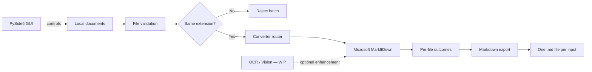

<div align="center">


# 📄 Hybrid Document to Markdown

### A local-first Windows desktop converter powered by Python and Microsoft MarkItDown

[](#-roadmap)
[](#-testing)
[](#-technology-stack)

[](https://github.com/microsoft/markitdown)
[](https://doc.qt.io/qtforpython-6/)
[](#-requirements)
[](LICENSE)

**Convert common documents into readable Markdown without rebuilding format-specific parsers from scratch.**<br>
**The project combines a tested conversion core with a beginner-friendly Windows desktop workflow.**

[Overview](#-overview) •
[Features](#-feature-status) •
[Formats](#-supported-formats) •
[Quick Start](#-quick-start) •
[Architecture](#-architecture) •
[Roadmap](#-roadmap)

</div>

---

> [!IMPORTANT]
> Phase D is complete: the conversion core and branded PySide6 desktop workflow are implemented and tested. Phase E—consent-based OCR/Vision enhancement—is now the active checkpoint. There is no packaged Windows executable yet.

> [!NOTE]
> This is an independent portfolio project that uses [Microsoft MarkItDown](https://github.com/microsoft/markitdown). It is not an official Microsoft product and is not affiliated with or endorsed by Microsoft.

## 📚 Table of Contents

- [Overview](#-overview)
- [Feature Status](#-feature-status)
- [Supported Formats](#-supported-formats)
- [How Conversion Works](#-how-conversion-works)
- [Quick Start](#-quick-start)
  - [Requirements](#-requirements)
  - [Installation](#-installation)
  - [Run the Desktop App](#-run-the-desktop-app)
  - [Run the Tests](#-run-the-tests)
  - [Use the Core API](#-use-the-core-api)
- [Batch Rules and Validation](#-batch-rules-and-validation)
- [Architecture](#-architecture)
- [Project Structure](#-project-structure)
- [Testing](#-testing)
- [Privacy and Limitations](#-privacy-and-limitations)
- [Technology Stack](#-technology-stack)
- [Roadmap](#-roadmap)
- [Engineering Principles](#-engineering-principles)
- [License and Credits](#-license-and-credits)

## 🔎 Overview

<table>
<tr>
<td width="50%" valign="top">
<h3>🎯 What it does</h3>
<p>Hybrid Document to Markdown converts common documents into Markdown (<code>.md</code>). It targets users who want a clear Windows workflow instead of manual conversion commands.</p>
<ul>
<li>Validates local documents</li>
<li>Routes multiple file formats</li>
<li>Processes safe same-extension batches</li>
<li>Preserves independent file outcomes</li>
<li>Exports UTF-8 Markdown</li>
</ul>
</td>
<td width="50%" valign="top">
<h3>💡 Why it exists</h3>
<p>Maintaining a custom parser for every format is expensive. This project delegates parsing to MarkItDown and focuses on user experience, reliability, testing, and Windows delivery.</p>
<ul>
<li>Local-first processing</li>
<li>Predictable validation</li>
<li>Transparent errors</li>
<li>PySide6 desktop usability</li>
<li>Reproducible integration tests</li>
</ul>
</td>
</tr>
</table>

> [!NOTE]
> Earlier custom TXT-converter code remains as a learning milestone. MarkItDown is the production engine.

## ✨ Feature Status

<table>
<tr>
<td width="50%" valign="top">
<h3>✅ Implemented</h3>
<ul>
<li>Multi-format conversion core</li>
<li>Same-extension batch conversion</li>
<li>Independent per-file outcomes</li>
<li>Existence, type, extension, size, and readability validation</li>
<li>UTF-8 Markdown export with overwrite protection</li>
<li>Accessible file picker and drag and drop</li>
<li>Threaded conversion with per-file status</li>
<li>Markdown preview, copy, and collision-safe export</li>
<li>Low-glare dark-medieval pixel theme with a TXT-first file selector</li>
<li>Custom transparent pixel-art application and header logo</li>
<li>Scrollbars that appear only when content overflows</li>
<li>Progressive “Save Markdown” action shown after successful conversion</li>
<li>70 passing automated tests</li>
</ul>
</td>
<td width="50%" valign="top">
<h3>🚧 WIP &amp; planned</h3>
<ul>
<li><strong>WIP:</strong> consent-based OCR and Vision</li>
<li><strong>WIP:</strong> credential safety and offline fallback</li>
<li><strong>Planned:</strong> Windows executable and release</li>
</ul>
</td>
</tr>
</table>

## 🗃️ Supported Formats

Representative integration coverage exists for every MVP format.

| Category | Extensions | Dependency path | Verification |
|---|---|---|:---:|
| Plain text | `.txt` | MarkItDown core | ✅ Passed |
| Word | `.docx` | `markitdown[docx]` | ✅ Passed |
| PDF | `.pdf` | `markitdown[pdf]` | ✅ Text-based PDF passed |
| PowerPoint | `.pptx` | `markitdown[pptx]` | ✅ Passed |
| Excel | `.xlsx` | `markitdown[xlsx]` | ✅ Passed |
| Tabular data | `.csv` | MarkItDown core | ✅ Passed |
| Web documents | `.html`, `.htm` | MarkItDown core | ✅ Passed |
| Structured text | `.json`, `.xml` | MarkItDown core | ✅ Passed |

> [!WARNING]
> “Supported” does not mean perfect visual fidelity. Scanned PDFs, embedded images, complex layouts, nested tables, diagrams, encrypted documents, and damaged files may produce incomplete results or require manual review.

Emails, archives, audio, EPUB, LOG files, and standalone image conversion are outside the committed MVP scope.

## 🔄 How Conversion Works



The conversion path is local by default. MarkItDown receives a local path through `convert_local()`. The application then converts the library response into its own `ConversionResult` model.

## 🚀 Quick Start

<table>
<tr>
<td width="38%" valign="top">
<h3 id="requirements">📋 Requirements</h3>
<ul>
<li>Windows 10 or 11</li>
<li>Python 3.13</li>
<li>Git and PowerShell</li>
<li>Internet during installation</li>
</ul>
<p>No API key is required for local conversion.</p>
<h3 id="run-the-tests">🧪 Test</h3>
<pre><code>python -m pytest -q</code></pre>
<p>Expected: <code>70 passed</code></p>
</td>
<td width="62%" valign="top">
<h3 id="installation">📦 Installation</h3>
<pre><code>git clone https://github.com/DrBham/Hybird-Document-To-Markdown.git
cd Hybird-Document-To-Markdown

python -m venv .venv
.\.venv\Scripts\Activate.ps1

python -m pip install -r requirements.txt
python -m pip check</code></pre>
<p>Activate <code>.venv</code> before developing or testing so project packages stay isolated.</p>
</td>
</tr>
</table>

> [!NOTE]
> The root-level `pytest.ini` adds `src` to pytest's import path. It is configuration, not a generated cache file.

### 🖥️ Run the Desktop App

From the repository root with the virtual environment active:

```powershell
$env:PYTHONPATH = "src"
python -m document_converter
```

The file-type selector starts at TXT. Choose another format when needed, then browse or drag matching documents, convert them, review a result, and choose an output folder. “Save Markdown” appears after at least one conversion succeeds. Conversion runs in a worker thread, so the window remains responsive.

### 🧑‍💻 Use the Core API

> [!NOTE]
> The desktop app is the recommended interactive workflow. The examples below show how to reuse the tested Python core directly.

Convert one file:

```python
from pathlib import Path

from document_converter.core.router import ConverterRouter
from document_converter.services.markdown_exporter import MarkdownExporter


source = Path("documents/report.pdf")

conversion = ConverterRouter().convert(source)
output = source.with_suffix(".md")

MarkdownExporter().export(
    conversion.markdown,
    output,
    overwrite=False,
)

print(f"Saved: {output}")
```

Convert a same-extension batch:

```python
from pathlib import Path

from document_converter.services.batch_converter import BatchConverter


files = [
    Path("documents/report.pdf"),
    Path("documents/manual.pdf"),
    Path("documents/tutorial.PDF"),
]

batch = BatchConverter().convert(files)

for outcome in batch.outcomes:
    if outcome.succeeded:
        print(f"Converted: {outcome.source_path.name}")
    else:
        print(f"Failed: {outcome.source_path.name} — {outcome.error}")
```

When running a standalone development script from the repository root, expose the `src` directory first:

```powershell
$env:PYTHONPATH = "src"
python .\your_script.py
```

## 🛡️ Batch Rules and Validation

<table>
<tr>
<td width="50%" valign="top">
<h3>📚 Batch rules</h3>
<ul>
<li>At least one file is required.</li>
<li>All extensions must match, ignoring case.</li>
<li>Each file converts independently.</li>
<li>Successful results survive other failures.</li>
<li>Files are never merged automatically.</li>
</ul>
<p><strong>Allowed:</strong> <code>report.pdf</code>, <code>manual.PDF</code></p>
<p><strong>Rejected:</strong> <code>report.pdf</code>, <code>slides.pptx</code></p>
</td>
<td width="50%" valign="top">
<h3>🛡️ File validation</h3>
<ul>
<li>The path exists.</li>
<li>The path points to a file.</li>
<li>The extension is on the MVP allowlist.</li>
<li>The file is no larger than 100 MiB.</li>
<li>The file can be opened for reading.</li>
</ul>
<p>Validation happens before MarkItDown receives the document.</p>
</td>
</tr>
</table>

## 🏗️ Architecture

| Layer | Responsibility | Main components |
|---|---|---|
| Core models | Stable application-level results | `ConversionResult`, `FileConversionOutcome`, `BatchConversionResult` |
| Validation | Reject invalid input early | `validate_file()` |
| Routing | Select the converter by extension | `ConverterRouter` |
| Conversion adapter | Isolate the third-party engine | `MarkItDownConverter` |
| Services | Coordinate batches and export | `BatchConverter`, `MarkdownExporter` |
| GUI | Desktop interaction | PySide6 window, worker thread, preview, and export workflow |

### Why an adapter?

`MarkItDownConverter` keeps third-party details behind the project's `BaseConverter` interface. The rest of the application works with its own models instead of depending directly on MarkItDown internals.

This design provides:

- Easier unit testing with fake engines
- Clear ownership boundaries
- Lower migration cost if the engine API changes
- Reusable core logic for the desktop GUI and future integrations

## 🗂️ Project Structure

```text
.
├── src/
│   └── document_converter/
│       ├── __main__.py
│       ├── converters/
│       │   ├── markitdown_converter.py
│       │   └── txt_converter.py
│       ├── core/
│       │   ├── base_converter.py
│       │   ├── models.py
│       │   ├── router.py
│       │   └── validator.py
│       ├── gui/
│       │   ├── app.py
│       │   ├── main_window.py
│       │   └── theme.py
│       └── services/
│           ├── batch_converter.py
│           └── markdown_exporter.py
├── design-system/
│   └── hybrid-document-to-markdown/
│       └── MASTER.md
├── assets/
│   ├── branding/
│   │   └── app-logo.png
│   └── fonts/
│       ├── PressStart2P-Regular.ttf
│       ├── PressStart2P-OFL.txt
│       └── PressStart2P-FONTLOG.txt
├── tests/
├── pytest.ini
├── requirements.in
├── requirements.txt
├── THIRD_PARTY_NOTICES.md
└── README.md
```

## 🧪 Testing

The test suite focuses on application behavior and third-party integration boundaries. It does not pretend to test MarkItDown's internal algorithms as original project code.

<table>
<tr>
<td width="50%" valign="top">
<h3>🔌 Integration coverage</h3>
<ul>
<li>All agreed MVP extensions</li>
<li>Real TXT, DOCX, and text-based PDF conversion</li>
<li>Real PPTX and XLSX conversion</li>
<li>Real CSV, HTML/HTM, JSON, and XML conversion</li>
</ul>
</td>
<td width="50%" valign="top">
<h3>⚙️ Behavior coverage</h3>
<ul>
<li>Invalid, oversized, and unreadable files</li>
<li>Case-insensitive and mixed-extension batches</li>
<li>Partial failures and result preservation</li>
<li>Unicode export and overwrite protection</li>
<li>GUI selection, state, threaded conversion, and export workflow</li>
</ul>
</td>
</tr>
</table>

Run the full suite with:

```powershell
python -m pytest -q
```

> [!NOTE]
> A local passing test badge is shown at the top because this repository does not yet have a GitHub Actions workflow. A live CI badge should replace it after CI is configured.

## 🔐 Privacy and Limitations

<table>
<tr>
<td width="50%" valign="top">
<h3>🔒 Local-first privacy</h3>
<ul>
<li>Local conversion needs no API key.</li>
<li>Ordinary local conversion requires no upload.</li>
<li>Internet loss must not block local processing.</li>
<li>Online enhancement will require explicit consent.</li>
<li>Secrets must never enter code, logs, Git, or output.</li>
</ul>
</td>
<td width="50%" valign="top">
<h3>⚠️ Current limitations</h3>
<ul>
<li>A packaged <code>.exe</code> is not available yet.</li>
<li>Scanned PDFs require future OCR support.</li>
<li>Complex layouts may lose fidelity.</li>
<li>Encrypted or damaged files may fail.</li>
<li>The 100 MiB limit is not yet configurable in the GUI.</li>
</ul>
</td>
</tr>
</table>

> [!IMPORTANT]
> No Vision provider has been selected. Azure Document Intelligence is outside this project's scope.

## 🧰 Technology Stack

| Area | Technology | Current role |
|---|---|---|
| Language | Python 3.13 | Application and tests |
| Desktop GUI | PySide6 6.12 | Implemented Phase D workflow |
| Conversion | Microsoft MarkItDown 0.1.9 | Production conversion engine |
| DOCX | Mammoth through `markitdown[docx]` | Word conversion |
| PDF | pdfminer.six and pdfplumber through `markitdown[pdf]` | Text-based PDF conversion |
| PowerPoint | python-pptx through `markitdown[pptx]` | PPTX conversion |
| Excel | pandas and openpyxl through `markitdown[xlsx]` | XLSX conversion |
| Testing | pytest | Unit and integration tests |
| Version control | Git and GitHub | History and collaboration |
| Target OS | Windows | Development and release target |

Direct dependencies are declared in `requirements.in`. The reproducible development snapshot is pinned in `requirements.txt`.

## 🗺️ Roadmap

| Phase | Deliverable | Status |
|---|---|:---:|
| Foundation (00–A) | Repository, environment, architecture, TXT learning milestone, and scope/documentation migration | ✅ Completed |
| B — Engine | MarkItDown integration and initial TXT/DOCX/PDF verification | ✅ Completed |
| C — Conversion core | All MVP formats, validation, same-extension batches, per-file outcomes, and export | ✅ Completed |
| D — Desktop GUI | Format selection, drag and drop, threaded conversion, status list, preview, Save Markdown workflow, theme, and branding | ✅ Completed |
| E — Enhancement | Consent-based OCR/Vision, credential safety, and offline fallback | 🚧 In progress |
| F — Release | Regression testing, Windows packaging, license audit, documentation, and GitHub release | 🗓️ Planned |

### Current checkpoint: E — Enhancement

Phase D delivered:

- TXT-first file-type selector with accessible browse and drag-and-drop alternatives
- Same-extension selected-file list
- Responsive threaded conversion with per-file status
- Markdown preview, copy action, and adaptive scrollbars
- Output-directory selection and overwrite handling
- Progressive Save Markdown action with collision-safe one-file-per-input output
- Low-glare dark-medieval pixel theme and custom application branding
- 70 passing automated tests

Checkpoint E will design and implement optional enhancement without weakening local-first behavior:

- Explicit consent before any online processing
- OCR/Vision acceptance criteria, boundaries, and provider decision
- Provider-independent interfaces before selecting an external service
- Credential storage, validation, and log redaction
- Clear offline fallback to local conversion
- Automated tests and privacy documentation for every enhancement path

> [!IMPORTANT]
> Phase E starts with requirements and security boundaries. No document will be uploaded and no provider SDK will be added until consent behavior, credential handling, privacy terms, costs, and offline fallback are documented and reviewed.

Development follows this milestone cycle:

```text
Implement → Test → Document → Commit → Push
```

After a checkpoint is complete, the next phase becomes WIP.

## 🧭 Engineering Principles

- Finish the application before expanding its scope.
- Prefer simple, testable modules over speculative abstractions.
- Reuse mature libraries instead of rebuilding their algorithms.
- Keep local conversion available without cloud credentials.
- Preserve successful batch results when another file fails.
- Never claim perfect conversion fidelity.
- Treat third-party output and errors as integration boundaries.
- Keep secrets and generated files out of Git.
- Document implemented and planned features separately.

## 📜 License and Credits

Original project code and documentation are licensed under the [MIT License](LICENSE), where the contributors own the applicable rights.

Third-party components remain under their own licenses. Review [THIRD_PARTY_NOTICES.md](THIRD_PARTY_NOTICES.md) for the current dependency inventory and release-audit checklist.

### Credits

- [Microsoft MarkItDown](https://github.com/microsoft/markitdown) — document-to-Markdown conversion engine
- [Qt for Python / PySide6](https://doc.qt.io/qtforpython-6/) — Windows desktop framework
- [pytest](https://docs.pytest.org/) — automated testing

---

<div align="center">

**Built as a practical Python portfolio project with transparent scope, reproducible tests, and local-first design.**

</div>
