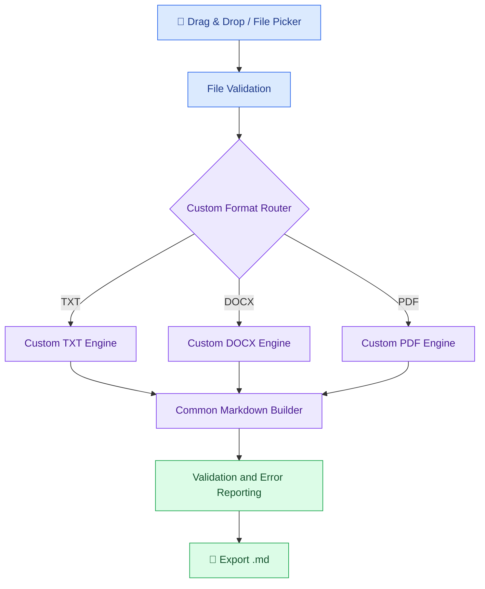

<div align="center">

# 📄 Document to Markdown
### Custom Desktop Converter

**Three essential formats. Three custom conversion engines. One local-first Python desktop app.**

[](#development-roadmap)
[](#technology-stack)
[](#technology-stack)
[](#supported-formats)

**[Overview](#overview) · [Features](#planned-features) · [Architecture](#custom-conversion-architecture) · [Roadmap](#development-roadmap) · [Credits](#license--credits)**

</div>

---

## Overview

**Document to Markdown Desktop Converter** is an independent, in-development Python desktop application designed to convert **TXT, DOCX, and PDF** files into structured, AI-friendly Markdown (`.md`). It focuses on common documents and a simple offline-first workflow.

**Custom-built conversion logic:** The application will implement its own format-specific conversion rules, Markdown builder, routing, validation, and desktop workflow. Established libraries may be used to parse source documents and construct the GUI; the production conversion pipeline will **not** rely on a ready-made document-to-Markdown converter such as MarkItDown.

> [!IMPORTANT]
> **Current status:** Environment setup and dependency cleanup are in progress. The converters and GUI are **planned, not implemented**. Fidelity of headings, lists, tables, and reading order is a testable goal, **not a 100% guarantee**, particularly for PDFs. OCR for scanned PDFs is out of scope for the first release.

## Planned Features

<table>
<tr>
<td width="50%" valign="top">

### 🖱️ Drag & Drop
Choose or drop documents using a desktop interface built with PySide6.

</td>
<td width="50%" valign="top">

### 🧩 Three Custom Engines
Write original TXT, DOCX, and PDF-to-Markdown conversion logic.

</td>
</tr>
<tr>
<td valign="top">

### 🏗️ Structure-Aware Output
Reconstruct headings, lists, tables, and reading order where the source allows.

</td>
<td valign="top">

### 🤖 AI-Friendly Markdown
Export readable `.md` files for AI-assisted workflows and knowledge bases.

</td>
</tr>
<tr>
<td valign="top">

### 🧪 Testable Algorithms
Validate results with representative files, regression tests, and edge cases.

</td>
<td valign="top">

### 🔒 Local-First
Process documents on the user's machine without required cloud uploads.

</td>
</tr>
</table>

## Supported Formats

| Format | Custom implementation plan | Status |
|:---:|---|:---:|
| 📃 **TXT** | Text structure detection, lists, and Markdown escaping | ⚪ Planned |
| 📘 **DOCX** | Heading, paragraph, numbering, and table mapping using parsed Word content | ⚪ Planned |
| 📕 **PDF** | Text/layout extraction and original structure-reconstruction heuristics | ⚪ Planned |

**Not in scope:** HTML and PPTX conversion. PDF OCR, password-protected PDFs, and perfect reconstruction of complex layouts are not part of the initial feature commitment.

## Custom Conversion Architecture



*Proposed design. Module boundaries and error handling will be finalized in Phase 2.*

## Technology Stack

<table>
<tr>
<td width="50%" valign="top">

**🐍 Conversion & Parsing**

- Python 3.13
- Python standard library — TXT logic
- [python-docx](https://python-docx.readthedocs.io/) — DOCX access/parsing
- [pdfplumber](https://github.com/jsvine/pdfplumber) — PDF text/layout access
- Original Markdown generation rules

</td>
<td width="50%" valign="top">

**🖥️ Desktop & Quality**

- [PySide6](https://doc.qt.io/qtforpython-6/) — desktop UI and drag-and-drop
- [pytest](https://docs.pytest.org/) — automated tests
- Git & GitHub — phase-by-phase version control
- Windows — first packaging target

</td>
</tr>
</table>

> The listed libraries are **parsing/UI/testing tools**, not third-party document-to-Markdown conversion engines. Dependency selection and licensing will be reviewed before the first release.

## Development Roadmap

Every milestone follows **implement → test → document → commit → push**.

| Phase | Milestone | Status |
|:---:|---|:---:|
| 00 | Repository and initial introduction | 🟢 Completed |
| 01 | Environment setup, dependency cleanup, and Git workflow | 🟡 In progress |
| 02 | Modular architecture and converter interfaces | ⚪ Planned |
| 03 | Custom TXT conversion engine | ⚪ Planned |
| 04 | Custom DOCX conversion engine | ⚪ Planned |
| 05 | Custom PDF conversion engine and layout heuristics | ⚪ Planned |
| 06 | Desktop GUI and drag-and-drop | ⚪ Planned |
| 07 | Automated tests and conversion quality evaluation | ⚪ Planned |
| 08 | Windows packaging, documentation, and release | ⚪ Planned |

**Legend:** 🟢 Completed · 🟡 In progress · ⚪ Planned

## Development Setup

**Prerequisites:** Windows, Git, Python 3.13.

```powershell
git clone https://github.com/DrBham/Hybrid-Document-To-Markdown.git
cd Hybrid-Document-To-Markdown
python -m venv .venv
.\.venv\Scripts\Activate.ps1
python -m pip install -r requirements.txt
python -m pip check
```

> **Development-only setup:** The application is not yet runnable. `requirements.txt` is generated after cleaning the environment to match the three-format scope.

## Engineering Principles

<table>
<tr>
<td width="50%" valign="top">

**🛠️ Learn by Building**

Write and explain the conversion rules rather than wrapping a ready-made Markdown converter.

</td>
<td width="50%" valign="top">

**📏 Measure, Don't Assume**

Test extraction completeness, structural fidelity, edge cases, and error handling; document limitations.

</td>
</tr>
</table>

## License & Credits

This independent portfolio project is **not affiliated with Microsoft**. [Microsoft MarkItDown](https://github.com/microsoft/markitdown) was evaluated during initial prototyping but is **not a dependency of the planned production application**. The repository retains its original `Hybrid-Document-To-Markdown` URL for continuity.

The project's own license, if selected, is defined in the root `LICENSE` file. Any third-party libraries used or redistributed must comply with their respective licenses. See [`THIRD_PARTY_NOTICES.md`](THIRD_PARTY_NOTICES.md), which will be revised to match the final dependency set.

---

<div align="center">

**One phase. One tested milestone. One documented commit.**

*Custom conversion logic, readable Markdown, transparent engineering.*

</div>
