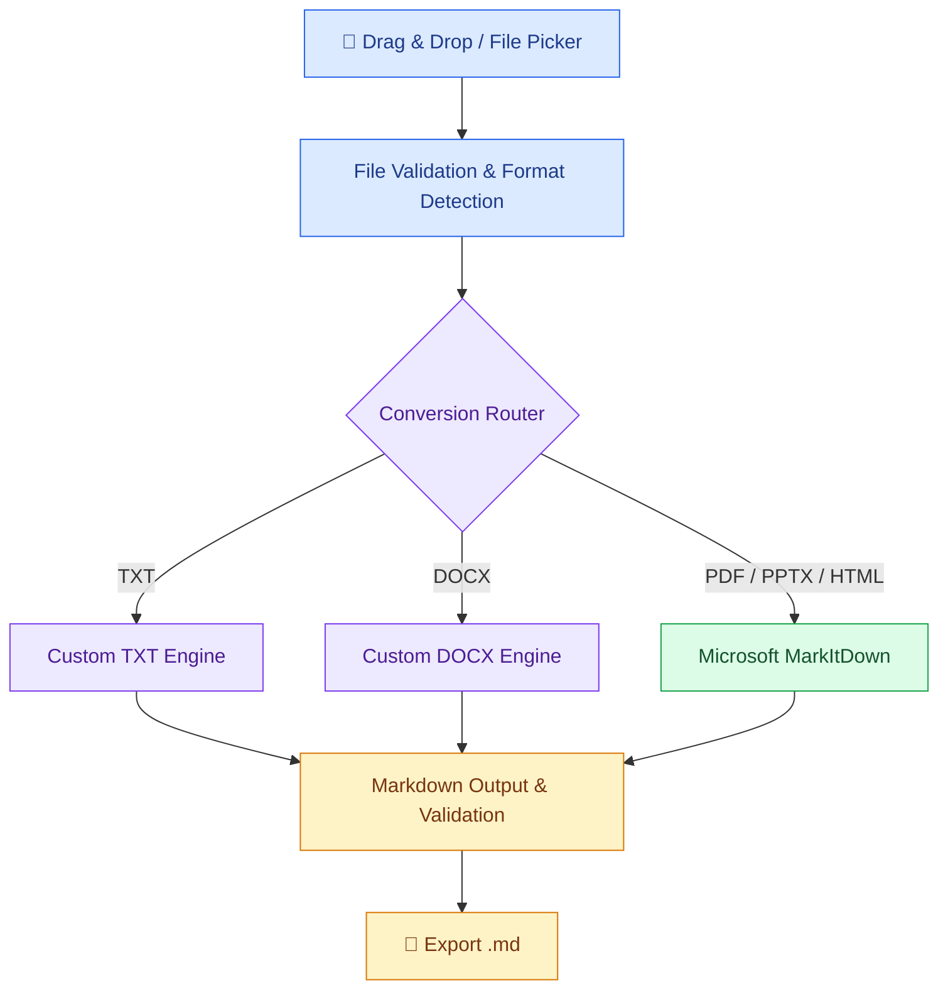

<div align="center">

# 📄 Hybrid Document to Markdown
### Desktop Converter

**Turn everyday documents into clean, AI-friendly Markdown — from one desktop workspace.**

[](#development-roadmap)
[](#technology-stack)
[](#technology-stack)
[](#license--attribution)

**[Overview](#overview) · [Features](#planned-features) · [Architecture](#hybrid-architecture) · [Roadmap](#development-roadmap) · [Credits](#license--attribution)**

</div>

---

## Overview

**Hybrid Document to Markdown Desktop Converter** is an in-development Python desktop application designed to convert five document formats into structured Markdown (`.md`) for AI-assisted reading, retrieval, and text analysis.

The project combines **Microsoft MarkItDown** with **independently developed TXT and DOCX conversion engines**, all accessible through a planned drag-and-drop desktop interface.

> [!IMPORTANT]
> **Current status: planning / repository initialization.** The features below are planned, not yet implemented. Document structure preservation is a quality objective, not a guarantee of 100% fidelity for every source file.

## Planned Features

<table>
<tr>
<td width="50%" valign="top">

### 🖱️ Drag & Drop
Drop supported documents into a simple desktop interface, without command-line conversion.

</td>
<td width="50%" valign="top">

### 🧩 Hybrid Conversion
Combine established open-source tooling with custom-built converters for TXT and DOCX.

</td>
</tr>
<tr>
<td valign="top">

### 🏗️ Structure-Aware Output
Aim to preserve heading hierarchy, lists, tables, and reading order wherever source information allows.

</td>
<td valign="top">

### 🤖 AI-Ready Markdown
Produce readable `.md` files suitable for downstream AI and document-processing workflows.

</td>
</tr>
<tr>
<td valign="top">

### 🔍 Validation & Testing
Test conversion behavior against representative documents and tricky formatting cases.

</td>
<td valign="top">

### 💻 Desktop-First Workflow
Build a responsive Python GUI with clear feedback and local file processing as the default goal.

</td>
</tr>
</table>

## Supported Formats (Planned)

<div align="center">

| 📘 DOCX | 📕 PDF | 📊 PPTX | 🌐 HTML | 📃 TXT |
|:---:|:---:|:---:|:---:|:---:|
| Custom engine | MarkItDown | MarkItDown | MarkItDown | Custom engine |
| Planned | Planned | Planned | Planned | Planned |

</div>

## Hybrid Architecture



> Routing, fallback behavior, and error handling will be refined and tested during the architecture and implementation phases.

## Technology Stack

<table>
<tr>
<td width="50%" valign="top">

**Core & Conversion**

- 🐍 Python 3.12
- 📦 [Microsoft MarkItDown](https://github.com/microsoft/markitdown)
- 📘 [python-docx](https://python-docx.readthedocs.io/)

</td>
<td width="50%" valign="top">

**Desktop & Engineering**

- 🖥️ [PySide6](https://doc.qt.io/qtforpython-6/)
- 🧪 pytest
- 🌿 Git & GitHub

</td>
</tr>
</table>

## Development Roadmap

Each completed phase will be tested, documented, committed, and pushed to GitHub.

| Phase | Milestone | Status |
|:---:|---|:---:|
| 00 | Repository & introductory documentation | 🟡 In progress |
| 01 | Environment setup & Git workflow | ⚪ Planned |
| 02 | Modular architecture & interfaces | ⚪ Planned |
| 03 | Custom TXT conversion engine | ⚪ Planned |
| 04 | Custom DOCX conversion engine | ⚪ Planned |
| 05 | Microsoft MarkItDown integration | ⚪ Planned |
| 06 | Desktop GUI & drag-and-drop | ⚪ Planned |
| 07 | Automated tests & quality evaluation | ⚪ Planned |
| 08 | Packaging, documentation & release | ⚪ Planned |

**Legend:** 🟢 Complete · 🟡 In progress · ⚪ Planned

## Getting Started

The application is **not yet available for installation**. To follow development, clone this repository after it has been created on GitHub:

```bash
git clone https://github.com/YOUR_USERNAME/hybrid-document-to-markdown.git
cd hybrid-document-to-markdown
```

> Replace `YOUR_USERNAME` with the repository owner's GitHub username. Installation and run instructions will be added after the implementation is ready.

## License & Attribution

This is an **independent project**, not an official Microsoft product and not affiliated with, sponsored by, or endorsed by Microsoft.

**Microsoft MarkItDown** is developed by Microsoft Corporation and distributed under the **MIT License**. The project plans to use MarkItDown as a third-party dependency for document conversion.

- Original project: https://github.com/microsoft/markitdown
- Original license: https://github.com/microsoft/markitdown/blob/main/LICENSE
- Copyright © Microsoft Corporation.
- See [`THIRD_PARTY_NOTICES.md`](THIRD_PARTY_NOTICES.md) for the license notice.

**License for this application's original code:** To be determined before public source distribution or release. Third-party packages may carry their own license obligations, which will be reviewed before packaging.

---

<div align="center">

**Built as a phase-by-phase Python desktop engineering portfolio project.**

*From documents to Markdown. From raw content to AI-ready structure.*

</div>
