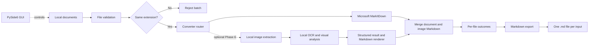

<div align="center">


# 📄 Hybrid Document to Markdown

### A local-first Windows desktop converter powered by Python and Microsoft MarkItDown

[](#-roadmap)
[](#-testing)
[](#-technology-stack)

[](https://github.com/microsoft/markitdown)
[](https://doc.qt.io/qtforpython-6/)
[](#-requirements)
[](LICENSE)

**Convert common documents into readable Markdown without rebuilding format-specific parsers from scratch.**<br>
**The project combines a tested conversion core with a beginner-friendly Windows desktop workflow.**

[Overview](#-overview) •
[Features](#-feature-status) •
[Formats](#-supported-formats) •
[Quick Start](#-quick-start) •
[Architecture](#-architecture) •
[Roadmap](#-roadmap)

</div>

---

> [!IMPORTANT]
> Phase D and checkpoints E0–E2 are complete. Phase E—fully local document intelligence—continues with E3 (dataset and reproducible training) as the current checkpoint. Installer work remains deferred until Phase E is complete.

> [!NOTE]
> This is an independent portfolio project that uses [Microsoft MarkItDown](https://github.com/microsoft/markitdown). It is not an official Microsoft product and is not affiliated with or endorsed by Microsoft.

## 📚 Table of Contents

- [Overview](#-overview)
- [Feature Status](#-feature-status)
- [Supported Formats](#-supported-formats)
- [How Conversion Works](#-how-conversion-works)
- [Quick Start](#-quick-start)
  - [Requirements](#-requirements)
  - [Installation](#-installation)
  - [Run the Desktop App](#-run-the-desktop-app)
  - [Run the Tests](#-run-the-tests)
  - [Use the Core API](#-use-the-core-api)
- [Batch Rules and Validation](#-batch-rules-and-validation)
- [Architecture](#-architecture)
- [Project Structure](#-project-structure)
- [Testing](#-testing)
- [Privacy and Limitations](#-privacy-and-limitations)
- [Technology Stack](#-technology-stack)
- [Roadmap](#-roadmap)
- [Engineering Principles](#-engineering-principles)
- [License and Credits](#-license-and-credits)

## 🔎 Overview

<table>
<tr>
<td width="50%" valign="top">
<h3>🎯 What it does</h3>
<p>Hybrid Document to Markdown converts common documents into Markdown (<code>.md</code>). It targets users who want a clear Windows workflow instead of manual conversion commands.</p>
<ul>
<li>Validates local documents</li>
<li>Routes multiple file formats</li>
<li>Processes safe same-extension batches</li>
<li>Preserves independent file outcomes</li>
<li>Exports UTF-8 Markdown</li>
</ul>
</td>
<td width="50%" valign="top">
<h3>💡 Why it exists</h3>
<p>Maintaining a custom parser for every format is expensive. This project delegates parsing to MarkItDown and focuses on user experience, reliability, testing, and Windows delivery.</p>
<ul>
<li>Local-first processing</li>
<li>Predictable validation</li>
<li>Transparent errors</li>
<li>PySide6 desktop usability</li>
<li>Reproducible integration tests</li>
</ul>
</td>
</tr>
</table>

> [!NOTE]
> Earlier custom TXT-converter code remains as a learning milestone. MarkItDown is the production engine.

## ✨ Feature Status

<table>
<tr>
<td width="50%" valign="top">
<h3>✅ Implemented</h3>
<ul>
<li>Multi-format conversion core</li>
<li>Same-extension batch conversion</li>
<li>Independent per-file outcomes</li>
<li>Existence, type, extension, size, and readability validation</li>
<li>UTF-8 Markdown export with overwrite protection</li>
<li>Accessible file picker and drag and drop</li>
<li>Threaded conversion with per-file status</li>
<li>Markdown preview, copy, and collision-safe export</li>
<li>Low-glare dark-medieval pixel theme with a TXT-first file selector</li>
<li>Custom transparent pixel-art application and header logo</li>
<li>Scrollbars that appear only when content overflows</li>
<li>Progressive “Save Markdown” action shown after successful conversion</li>
<li>Framework-independent schema for OCR, visual elements, and diagram relationships</li>
<li>Deterministic Markdown renderer for image-analysis results</li>
<li>Persistent local model registry with size and SHA-256 verification</li>
<li>Lazy PaddleOCR adapter with no cloud API dependency</li>
<li>OOXML image extraction and local PDF-page rendering</li>
<li>Corpus-level exact-match and character-error-rate evaluation</li>
<li>Reproducible OCR model-pack bootstrap and SHA-256 manifest generation</li>
<li>Real local OCR and image-only PDF pipeline smoke tests</li>
<li>Measured E2 acceptance gate covering quality, resources, GUI, integrity, and licensing</li>
<li>97 passing automated tests</li>
</ul>
</td>
<td width="50%" valign="top">
<h3>🚧 WIP &amp; planned</h3>
<ul>
<li><strong>Completed — E2:</strong> verified offline OCR baseline and model pack</li>
<li><strong>Active — E3:</strong> dataset provenance, stable splits, and quality controls</li>
<li><strong>Active — E3:</strong> reproducible preprocessing and fine-tuning workflow</li>
<li><strong>Planned — E4:</strong> diagram and informative-image understanding</li>
<li><strong>Planned — E5:</strong> end-to-end GUI acceptance and public model pack</li>
<li><strong>Deferred:</strong> Windows bootstrap installer and selectable model packs</li>
</ul>
</td>
</tr>
</table>

## 🗃️ Supported Formats

Representative integration coverage exists for every MVP format.

| Category | Extensions | Dependency path | Verification |
|---|---|---|:---:|
| Plain text | `.txt` | MarkItDown core | ✅ Passed |
| Word | `.docx` | `markitdown[docx]` | ✅ Passed |
| PDF | `.pdf` | `markitdown[pdf]` | ✅ Text-based PDF passed |
| PowerPoint | `.pptx` | `markitdown[pptx]` | ✅ Passed |
| Excel | `.xlsx` | `markitdown[xlsx]` | ✅ Passed |
| Tabular data | `.csv` | MarkItDown core | ✅ Passed |
| Web documents | `.html`, `.htm` | MarkItDown core | ✅ Passed |
| Structured text | `.json`, `.xml` | MarkItDown core | ✅ Passed |

> [!WARNING]
> “Supported” does not mean perfect visual fidelity. Standard conversion handles document text today. Scanned pages, embedded images, and diagrams remain Phase E work and may still require manual review.

Emails, archives, audio, EPUB, LOG files, and standalone image conversion are outside the committed MVP scope.

## 🔄 How Conversion Works



The conversion path is fully local. MarkItDown receives a local path through `convert_local()`. The application then converts the library response into its own `ConversionResult` model. Phase E follows the same boundary: local model files enter a replaceable backend and return application-owned result objects.

## 🚀 Quick Start

<table>
<tr>
<td width="38%" valign="top">
<h3 id="requirements">📋 Requirements</h3>
<ul>
<li>Windows 10 or 11</li>
<li>Python 3.13</li>
<li>Git and PowerShell</li>
<li>Internet during installation</li>
</ul>
<p>No API key is required for local conversion.</p>
<h3 id="run-the-tests">🧪 Test</h3>
<pre><code>python -m pytest -q</code></pre>
<p>Expected: <code>70 passed</code></p>
</td>
<td width="62%" valign="top">
<h3 id="installation">📦 Installation</h3>
<pre><code>git clone https://github.com/DrBham/Hybird-Document-To-Markdown.git
cd Hybird-Document-To-Markdown

python -m venv .venv
.\.venv\Scripts\Activate.ps1

python -m pip install -r requirements.txt
python -m pip check</code></pre>
<p>Activate <code>.venv</code> before developing or testing so project packages stay isolated.</p>
</td>
</tr>
</table>

> [!NOTE]
> The root-level `pytest.ini` adds `src` to pytest's import path. It is configuration, not a generated cache file.

### 🖥️ Run the Desktop App

From the repository root with the virtual environment active:

```powershell
$env:PYTHONPATH = "src"
python -m document_converter
```

The file-type selector starts at TXT. Choose another format when needed, then browse or drag matching documents, convert them, review a result, and choose an output folder. “Save Markdown” appears after at least one conversion succeeds. Conversion runs in a worker thread, so the window remains responsive.

### 👁️ Prepare the Optional Local Intelligence Runtime

The base converter does not install machine-learning packages. Developers who work on Phase E can create a separate environment layer:

```powershell
python -m pip install -r requirements-intelligence.txt
```

This optional layer uses PaddleOCR as the first pretrained OCR baseline. Build the current versioned model pack after installing the dependencies:

```powershell
$env:PYTHONPATH = "src"
python scripts/bootstrap_ocr_model.py --source huggingface
```

The bootstrap stores the models in the per-user application-data directory, records their SHA-256 checksums, and verifies the pack before use. The GUI enables **Analyze document images locally** only while that integrity check passes.

> [!IMPORTANT]
> No API key or hosted inference provider is used. The one-time bootstrap downloads upstream model weights; inference after that runs locally. The E2 license review is complete, but an E5 public pack must include the Apache-2.0 notice and pass a final artifact audit.

Reproduce the attributed E2 smoke evaluation:

```powershell
python scripts/fetch_e2_corpus.py
$env:PYTHONPATH = "src"
python scripts/evaluate_e2_corpus.py
```

The downloaded corpus and generated results stay in ignored local directories. Their source URLs, licenses, and checksums remain tracked in the repository manifest.

The complete E2 gate additionally consumes the synthetic benchmark and GUI-acceptance JSON evidence:

```powershell
$env:PYTHONPATH = "src"
python scripts/generate_e2_fixture.py .e2-results/network.png
python scripts/generate_e2_fixture.py .e2-results/network.pdf
python scripts/benchmark_ocr.py .e2-results/network.png `
  --reference "TOPOLOGI JARINGAN KANTOR INTERNET ROUTER UTAMA 1 GBPS SWITCH LANTAI 1 KOMPUTER ADMIN" `
  --json-output .e2-results/network-benchmark.json
python scripts/run_e2_gui_acceptance.py .e2-results/network.pdf
python scripts/validate_e2_acceptance.py
```

The thresholds are versioned in `datasets/manifests/e2-acceptance-policy.json`; generated evidence remains outside Git.

### 🧑‍💻 Use the Core API

> [!NOTE]
> The desktop app is the recommended interactive workflow. The examples below show how to reuse the tested Python core directly.

Convert one file:

```python
from pathlib import Path

from document_converter.core.router import ConverterRouter
from document_converter.services.markdown_exporter import MarkdownExporter


source = Path("documents/report.pdf")

conversion = ConverterRouter().convert(source)
output = source.with_suffix(".md")

MarkdownExporter().export(
    conversion.markdown,
    output,
    overwrite=False,
)

print(f"Saved: {output}")
```

Convert a same-extension batch:

```python
from pathlib import Path

from document_converter.services.batch_converter import BatchConverter


files = [
    Path("documents/report.pdf"),
    Path("documents/manual.pdf"),
    Path("documents/tutorial.PDF"),
]

batch = BatchConverter().convert(files)

for outcome in batch.outcomes:
    if outcome.succeeded:
        print(f"Converted: {outcome.source_path.name}")
    else:
        print(f"Failed: {outcome.source_path.name} — {outcome.error}")
```

When running a standalone development script from the repository root, expose the `src` directory first:

```powershell
$env:PYTHONPATH = "src"
python .\your_script.py
```

## 🛡️ Batch Rules and Validation

<table>
<tr>
<td width="50%" valign="top">
<h3>📚 Batch rules</h3>
<ul>
<li>At least one file is required.</li>
<li>All extensions must match, ignoring case.</li>
<li>Each file converts independently.</li>
<li>Successful results survive other failures.</li>
<li>Files are never merged automatically.</li>
</ul>
<p><strong>Allowed:</strong> <code>report.pdf</code>, <code>manual.PDF</code></p>
<p><strong>Rejected:</strong> <code>report.pdf</code>, <code>slides.pptx</code></p>
</td>
<td width="50%" valign="top">
<h3>🛡️ File validation</h3>
<ul>
<li>The path exists.</li>
<li>The path points to a file.</li>
<li>The extension is on the MVP allowlist.</li>
<li>The file is no larger than 100 MiB.</li>
<li>The file can be opened for reading.</li>
</ul>
<p>Validation happens before MarkItDown receives the document.</p>
</td>
</tr>
</table>

## 🏗️ Architecture

| Layer | Responsibility | Main components |
|---|---|---|
| Core models | Stable application-level results | `ConversionResult`, `FileConversionOutcome`, `BatchConversionResult` |
| Validation | Reject invalid input early | `validate_file()` |
| Routing | Select the converter by extension | `ConverterRouter` |
| Conversion adapter | Isolate the third-party engine | `MarkItDownConverter` |
| Services | Coordinate batches and export | `BatchConverter`, `MarkdownExporter` |
| Local intelligence schema | Keep OCR and diagram output independent of ML frameworks | `DocumentIntelligenceResult`, `TextRegion`, `VisualElement`, `VisualRelationship` |
| Local model integrity | Locate persistent model packs and reject incomplete or modified artifacts | `LocalModelManager` |
| OCR backend | Adapt local PaddleOCR results without importing it in the base app | `PaddleOCRBackend` |
| Image extraction | Extract OOXML media and render PDF pages locally | `DocumentImageExtractor` |
| Intelligence rendering | Produce reviewable Markdown from structured image results | `LocalDocumentIntelligence`, `render_intelligence_markdown()` |
| Evaluation | Compare model versions with stable corpus-level OCR metrics | `evaluate_ocr_samples()`, `scripts/evaluate_ocr.py` |
| GUI | Desktop interaction | PySide6 window, worker thread, preview, and export workflow |

### Why an adapter?

`MarkItDownConverter` keeps third-party details behind the project's `BaseConverter` interface. The rest of the application works with its own models instead of depending directly on MarkItDown internals.

This design provides:

- Easier unit testing with fake engines
- Clear ownership boundaries
- Lower migration cost if the engine API changes
- Reusable core logic for the desktop GUI and future integrations

## 🗂️ Project Structure

```text
.
├── src/
│   └── document_converter/
│       ├── __main__.py
│       ├── converters/
│       │   ├── markitdown_converter.py
│       │   └── txt_converter.py
│       ├── core/
│       │   ├── base_converter.py
│       │   ├── models.py
│       │   ├── router.py
│       │   └── validator.py
│       ├── gui/
│       │   ├── app.py
│       │   ├── main_window.py
│       │   └── theme.py
│       ├── intelligence/
│       │   ├── backend.py
│       │   ├── converter.py
│       │   ├── evaluation.py
│       │   ├── extractor.py
│       │   ├── model_manager.py
│       │   ├── model_pack.py
│       │   ├── models.py
│       │   ├── paddle_ocr.py
│       │   ├── pipeline.py
│       │   ├── renderer.py
│       │   └── service.py
│       └── services/
│           ├── batch_converter.py
│           └── markdown_exporter.py
├── design-system/
│   └── hybrid-document-to-markdown/
│       └── MASTER.md
├── assets/
│   ├── branding/
│   │   └── app-logo.png
│   └── fonts/
│       ├── PressStart2P-Regular.ttf
│       ├── PressStart2P-OFL.txt
│       └── PressStart2P-FONTLOG.txt
├── tests/
├── datasets/
│   ├── manifests/
│   │   ├── e2-acceptance-policy.json
│   │   └── e2-paddleocr-smoke.json
│   └── README.md
├── docs/
│   └── evaluations/
│       ├── E2_BASELINE.md
│       └── E2_MODEL_LICENSE_REVIEW.md
├── scripts/
│   ├── benchmark_ocr.py
│   ├── bootstrap_ocr_model.py
│   ├── evaluate_e2_corpus.py
│   ├── evaluate_ocr.py
│   ├── fetch_e2_corpus.py
│   ├── generate_e2_fixture.py
│   ├── run_e2_gui_acceptance.py
│   ├── run_e2_pipeline.py
│   └── validate_e2_acceptance.py
├── pytest.ini
├── requirements.in
├── requirements-intelligence.in
├── requirements-intelligence.txt
├── requirements.txt
├── THIRD_PARTY_NOTICES.md
└── README.md
```

## 🧪 Testing

The test suite focuses on application behavior and third-party integration boundaries. It does not pretend to test MarkItDown's internal algorithms as original project code.

<table>
<tr>
<td width="50%" valign="top">
<h3>🔌 Integration coverage</h3>
<ul>
<li>All agreed MVP extensions</li>
<li>Real TXT, DOCX, and text-based PDF conversion</li>
<li>Real PPTX and XLSX conversion</li>
<li>Real CSV, HTML/HTM, JSON, and XML conversion</li>
</ul>
</td>
<td width="50%" valign="top">
<h3>⚙️ Behavior coverage</h3>
<ul>
<li>Invalid, oversized, and unreadable files</li>
<li>Case-insensitive and mixed-extension batches</li>
<li>Partial failures and result preservation</li>
<li>Unicode export and overwrite protection</li>
<li>GUI selection, state, threaded conversion, and export workflow</li>
<li>Local intelligence result validation, Markdown rendering, model integrity, and OCR adapter boundaries</li>
</ul>
</td>
</tr>
</table>

Run the full suite with:

```powershell
python -m pytest -q
```

> [!NOTE]
> A local passing test badge is shown at the top because this repository does not yet have a GitHub Actions workflow. A live CI badge should replace it after CI is configured.

## 🔐 Privacy and Limitations

<table>
<tr>
<td width="50%" valign="top">
<h3>🔒 Local-first privacy</h3>
<ul>
<li>Conversion and planned image analysis need no API key.</li>
<li>Documents are not uploaded by the application.</li>
<li>Installed model packs remain available without internet access.</li>
<li>Model artifacts are verified before use.</li>
<li>The base converter remains usable without the optional ML runtime.</li>
</ul>
</td>
<td width="50%" valign="top">
<h3>⚠️ Current limitations</h3>
<ul>
<li>A packaged <code>.exe</code> is not available yet.</li>
<li>The E2 baseline passed local end-to-end acceptance, but it is not a full diagram-understanding model.</li>
<li>The first public, project-trained model pack is not published yet.</li>
<li>Complex layouts may lose fidelity.</li>
<li>Encrypted or damaged files may fail.</li>
<li>The 100 MiB limit is not yet configurable in the GUI.</li>
</ul>
</td>
</tr>
</table>

> [!IMPORTANT]
> Phase E is designed for local inference. Dataset licenses, model licenses, weight size, accuracy, and hardware performance will be reviewed before any trained model is published.

## 🧰 Technology Stack

| Area | Technology | Current role |
|---|---|---|
| Language | Python 3.13 | Application and tests |
| Desktop GUI | PySide6 6.12 | Implemented Phase D workflow |
| Conversion | Microsoft MarkItDown 0.1.9 | Production conversion engine |
| Local OCR baseline | PaddleOCR 3.7.0 + PaddlePaddle 3.3.1 | Optional Phase E runtime; not part of the base install |
| Intelligence layer | Project-owned Python interfaces and result models | OCR, visual elements, relationships, model integrity, and Markdown rendering |
| DOCX | Mammoth through `markitdown[docx]` | Word conversion |
| PDF | pdfminer.six and pdfplumber through `markitdown[pdf]` | Text-based PDF conversion |
| PowerPoint | python-pptx through `markitdown[pptx]` | PPTX conversion |
| Excel | pandas and openpyxl through `markitdown[xlsx]` | XLSX conversion |
| Testing | pytest | Unit and integration tests |
| Version control | Git and GitHub | History and collaboration |
| Target OS | Windows | Development and release target |

Base dependencies are declared in `requirements.in`, while the optional Phase E runtime is declared in `requirements-intelligence.in`. Reproducible snapshots are pinned separately in `requirements.txt` and `requirements-intelligence.txt`.

## 🗺️ Roadmap

| Phase | Deliverable | Status |
|---|---|:---:|
| Foundation (00–A) | Repository, environment, architecture, TXT learning milestone, and scope/documentation migration | ✅ Completed |
| B — Engine | MarkItDown integration and initial TXT/DOCX/PDF verification | ✅ Completed |
| C — Conversion core | All MVP formats, validation, same-extension batches, per-file outcomes, and export | ✅ Completed |
| D — Desktop GUI | Format selection, drag and drop, threaded conversion, status list, preview, Save Markdown workflow, theme, and branding | ✅ Completed |
| E — Local document intelligence | OCR, embedded-image extraction, diagram understanding, training/evaluation, and publishable model packs | 🚧 In progress |
| F — Release | Regression testing, bootstrap installer, selectable feature packs, license audit, and GitHub release | ⏸️ Deferred until E is complete |

### Current checkpoint: E3 — Dataset & Training

Phase D delivered:

- TXT-first file-type selector with accessible browse and drag-and-drop alternatives
- Same-extension selected-file list
- Responsive threaded conversion with per-file status
- Markdown preview, copy action, and adaptive scrollbars
- Output-directory selection and overwrite handling
- Progressive Save Markdown action with collision-safe one-file-per-input output
- Low-glare dark-medieval pixel theme and custom application branding
- Phase D baseline: 70 passing automated tests

Checkpoint E now has a local, testable foundation:

- Framework-independent OCR and diagram result schema
- Deterministic image-analysis Markdown renderer
- Persistent model directory with version, size, and SHA-256 validation
- Lazy PaddleOCR adapter using local detection and recognition directories
- Local extraction of embedded OOXML images and rendered PDF pages
- Best-effort composition of image analysis with existing Markdown conversion
- Reproducible exact-match and character-error-rate evaluation utilities
- Optional dependency layer that does not enlarge the base converter
- GUI status that clearly distinguishes missing, damaged, ready, and not-yet-connected model states
- No API keys, cloud uploads, or hosted Vision client
- Reproducible mobile OCR model-pack bootstrap
- Successful real OCR and image-only PDF end-to-end smoke tests
- Reproducible E2 acceptance policy and machine-readable result
- Real GUI conversion acceptance with the verified local model
- Completed E2 model-license review with an E5 release-compliance boundary
- 97 passing automated tests

Current E2 baseline:

| Evidence | Result |
|---|---:|
| Local model pack | Ready; 19.10 MiB; SHA-256 verified |
| Primary optional OCR runtime | ~515 MiB installed in the development environment |
| OCR models | PP-LCNet orientation + PP-OCRv5 mobile detection + Latin recognition |
| Synthetic network-diagram CER | 2.38% |
| Cold / warm CPU inference | 5.41 s / 2.75 s average |
| Process RSS increase | 264.82 MiB |
| Official five-fixture snippet recall | 100% (24/24); smoke corpus only |
| Rotated-book snippet recall | Improved from 0/4 in v1 to 4/4 in v2 |
| Image-only PDF pipeline | Passed; local analysis appended to Markdown |
| GUI acceptance | Passed; option enabled, conversion succeeded, analysis rendered |
| E2 acceptance gate | Passed; 12/12 checks |

See the full [E2 baseline report](docs/evaluations/E2_BASELINE.md) and [model-license review](docs/evaluations/E2_MODEL_LICENSE_REVIEW.md) for the evidence and release boundary. The ~515 MiB optional development runtime is isolated from the base converter and remains an E5 packaging optimization target.

### Phase E execution plan

| Checkpoint | Scope | Exit criteria | Status |
|---|---|---|:---:|
| E0 — Architecture | Remove the cloud path; define local result, backend, renderer, and model interfaces | No API key or hosted runtime remains; unit tests pass | ✅ Completed |
| E1 — Extraction pipeline | Extract OOXML media, render PDF pages, merge analysis with document Markdown | DOCX/PPTX/XLSX extraction and real PDF rendering are tested | ✅ Completed |
| E2 — OCR baseline & model pack | Operate the local runtime and model pack, then evaluate representative OCR inputs | A verified model pack loads offline and meets documented quality/resource thresholds through the application pipeline | ✅ Completed |
| E3 — Dataset & training | Register licensed datasets, create stable splits, add preprocessing and fine-tuning scripts | Training is reproducible; every dataset and checkpoint has provenance and license metadata | 🚧 Active — WIP |
| E4 — Visual understanding | Detect diagram elements, labels, arrows, and relationships beyond plain OCR | Representative topology, flowchart, chart, and informative-image fixtures produce structured relationships | ⏳ Planned |
| E5 — Product integration | Refine GUI progress/errors, run quality and performance acceptance, publish the first ready-to-use model pack | A new user can enable local analysis and use it without training a model | ⏳ Planned |

#### What we work on next

E3 is the immediate development stage. The E2 baseline, resource thresholds, GUI acceptance, integrity checks, and model-license review are complete. Work now continues with:

1. Register candidate datasets with source, license, language, and privacy metadata.
2. Define stable Indonesian/English train, validation, and held-out test splits.
3. Add deterministic preprocessing and dataset-validation commands.
4. Add full manually verified references for per-category CER measurement.
5. Establish a reproducible fine-tuning configuration and checkpoint manifest.
6. Compare every trained checkpoint with the frozen E2 baseline before promotion.

E2 closed with 12/12 acceptance checks passing. Its five-file official corpus remains a smoke corpus; broader dataset construction, full-reference evaluation, and model training intentionally belong to E3.

### Phase E definition of done

Phase E can be marked complete when:

- document text and informative images are processed locally;
- the public model pack can be reused without user-side training;
- dataset and model licenses permit the intended distribution;
- OCR and diagram quality are measured against a stable test set;
- corrupted or incomplete model files are rejected safely;
- the GUI provides useful progress, errors, and fallback behavior;
- performance and storage targets are documented on representative Windows hardware;
- all regression and Phase E acceptance tests pass.

> [!IMPORTANT]
> Phase E is not complete yet. E0, E1, and E2 are complete; E3 is active. The GUI exposes local analysis when a valid model pack is installed and falls back safely when the pack is missing or damaged. Public packaging remains an E5 deliverable and requires the recorded Apache-2.0 notices plus a final artifact audit.

Development follows this milestone cycle:

```text
Implement → Test → Document → Commit → Push
```

After a checkpoint is complete, the next phase becomes WIP.

## 🧭 Engineering Principles

- Finish the application before expanding its scope.
- Prefer simple, testable modules over speculative abstractions.
- Reuse mature libraries instead of rebuilding their algorithms.
- Keep local conversion available without cloud credentials.
- Preserve successful batch results when another file fails.
- Never claim perfect conversion fidelity.
- Treat third-party output and errors as integration boundaries.
- Keep secrets and generated files out of Git.
- Document implemented and planned features separately.

## 📜 License and Credits

Original project code and documentation are licensed under the [MIT License](LICENSE), where the contributors own the applicable rights.

Third-party components remain under their own licenses. Review [THIRD_PARTY_NOTICES.md](THIRD_PARTY_NOTICES.md) for the current dependency inventory and release-audit checklist.

### Credits

- [Microsoft MarkItDown](https://github.com/microsoft/markitdown) — document-to-Markdown conversion engine
- [Qt for Python / PySide6](https://doc.qt.io/qtforpython-6/) — Windows desktop framework
- [pytest](https://docs.pytest.org/) — automated testing

---

<div align="center">

**Built as a practical Python portfolio project with transparent scope, reproducible tests, and local-first design.**

</div>
