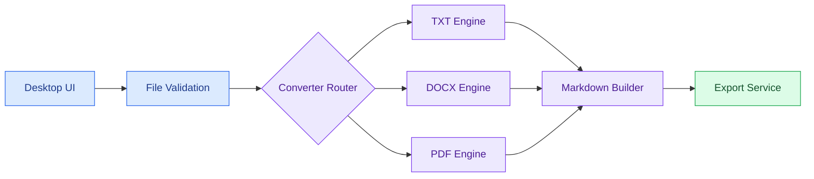

# Phase 2 — Software Architecture & Modular Design

**Status:** In Progress  
**Prerequisite:** Phase 1 — Environment & Repository Setup (Completed)  
**Scope:** TXT, DOCX, and text-based PDF. Scanned-PDF OCR, PPTX, and HTML are out of scope.

## Objective

Design a small, testable, extensible desktop conversion system before implementing file-format algorithms. The conversion pipeline will be custom-built. PySide6, python-docx, and pdfplumber may provide GUI and parsing capabilities, but no ready-made document-to-Markdown engine is planned.

## Subphase plan

| Subphase | Work item | Deliverable | Completion check | Status |
|:---:|---|---|---|:---:|
| 2.1 | Define module boundaries and responsibilities | Agreed source tree and responsibility map | Each module has one clear responsibility | 🟡 In progress |
| 2.2 | Define conversion contracts and shared data types | Abstract converter interface and result types | Interface passes basic unit tests | ⚪ Planned |
| 2.3 | Design file validation and converter routing | Validator and router components | TXT/DOCX/PDF route tests pass; unsupported inputs are rejected | ⚪ Planned |
| 2.4 | Design Markdown builder and output handling | Shared builder and export contract | Escaping, output path, and error tests pass | ⚪ Planned |
| 2.5 | Integrate architectural skeleton and assess knowledge | Minimal end-to-end scaffold and assessment | Test suite passes; architecture can be explained without notes | ⚪ Planned |

> A subphase becomes Complete only after its deliverable is built and verified. Commit and push the complete Phase 2 milestone after the final review.

## Proposed module layout

```text
src/
  document_to_markdown/
    __init__.py
    core/
      __init__.py
      contracts.py
      models.py
      router.py
      validator.py
      markdown_builder.py
    converters/
      __init__.py
      txt_converter.py
      docx_converter.py
      pdf_converter.py
    ui/
      __init__.py
    services/
      __init__.py
      exporter.py
tests/
  unit/
  integration/
docs/
  PHASE_02.md
```

This layout is a **proposal**, not a claim that these files already exist. Folder and file creation will be guided one subphase at a time.

## Responsibility map

| Layer | Responsibility | Does not do |
|---|---|---|
| UI | Collect files, display progress and errors | Parse documents or generate Markdown |
| Validation | Check paths, supported formats, and basic constraints | Choose visual styling |
| Router | Select the appropriate custom converter | Parse PDF/DOCX internals |
| Converters | Interpret source-specific content as structured elements | Write output files directly |
| Markdown builder | Turn structured elements into Markdown | Read PDF/DOCX binary formats |
| Export service | Write Markdown to an output path safely | Decide heading or list semantics |

## Architecture overview



## Subphase 2.1 — First learning task

Review the module tree and responsibility map. Explain why document parsing, Markdown formatting, file output, and UI events should be separated. Do not implement converters yet; the first practical action will be to create the package skeleton and verify that Python can import it.

## Assessment questions

1. What is the difference between a converter and the converter router?
2. Why should a converter return a result instead of writing `.md` files itself?
3. Which component should reject an unsupported `.pptx` file?
4. Why is Markdown escaping implemented in a shared component?
5. What information should be preserved for debugging when PDF structure inference fails?

## Phase exit criteria

- [ ] Proposed module structure is implemented and importable.
- [ ] Conversion interface and models are covered by unit tests.
- [ ] Format validation and routing pass positive and negative tests.
- [ ] Markdown builder and exporter have focused tests.
- [ ] The architecture is demonstrated and the assessment is completed.
- [ ] README and phase status are updated in English.
- [ ] Phase 2 changes are committed and pushed to GitHub.
